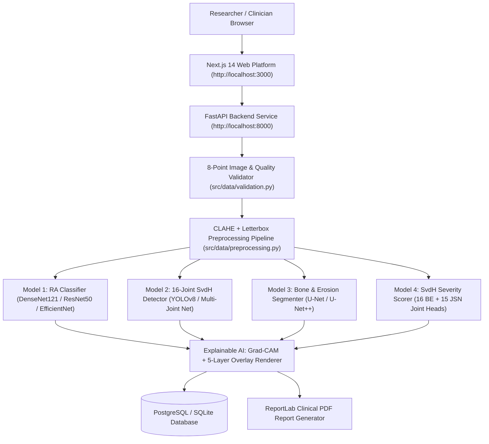

# RheumaVision AI — AI-Powered Rheumatological X-Ray Analysis Platform

[](https://www.python.org/)
[](https://pytorch.org/)
[](https://fastapi.tiangolo.com/)
[](https://nextjs.org/)
[](https://huggingface.co/datasets/TokyoTechMagicYang/RAM-H1200-v1)
[](https://creativecommons.org/licenses/by-nc-sa/4.0/)

**RheumaVision AI** is a research-oriented, end-to-end machine learning and full-stack medical imaging platform designed to analyze **Posterior-Anterior (PA) Hand X-ray Radiographs** and identify radiographic abnormalities associated with **Rheumatoid Arthritis (RA)**.

Built around the multi-task **RAM-H1200 (`TokyoTechMagicYang/RAM-H1200-v1`)** benchmark, the platform integrates **four distinct deep-learning engines**, **Grad-CAM Explainable AI**, a **FastAPI inference & report backend**, **PostgreSQL/SQLAlchemy persistence**, **automated clinical PDF report generation**, and an interactive **Next.js 14 web dashboard**.

---

## Table of Contents

1. [Platform Highlights & Core Capabilities](#1-platform-highlights--core-capabilities)
2. [System Architecture](#2-system-architecture)
3. [RAM-H1200 Dataset Audit & Patient-Level Split Verification](#3-ram-h1200-dataset-audit--patient-level-split-verification)
4. [Multi-Model Deep Learning Pipeline](#4-multi-model-deep-learning-pipeline)
5. [Explainable AI & Multi-Layer Visualization](#5-explainable-ai--multi-layer-visualization)
6. [Repository Directory Structure](#6-repository-directory-structure)
7. [Quick Start & Local Installation](#7-quick-start--local-installation)
8. [REST API Reference](#8-rest-api-reference)
9. [Docker Deployment](#9-docker-deployment)
10. [Testing & Verification](#10-testing--verification)
11. [Medical Research Disclaimer](#11-medical-research-disclaimer)

---

## 1. Platform Highlights & Core Capabilities

- **Complete End-to-End ML Lifecycle:** Covers dataset acquisition, 8-point data validation, patient-level zero-leakage verification, CLAHE radiograph preprocessing, clinically constrained augmentation, multi-architecture training, test-set evaluation, and production inference.
- **Four Specialized Deep-Learning Engines:**
  1. **RA Pattern Classification Engine (`src/classification/`)**: Evaluates `DenseNet121`, `ResNet50`, and `EfficientNet-B0/B3` with temperature-calibrated probability outputs.
  2. **16-Joint SvdH Localization & Abnormality Detector (`src/detection/`)**: Localizes all 16 Sharp/van der Heijde (SvdH) hand joints and flags focal marginal erosions / joint space narrowing.
  3. **Bone & Erosion Segmentation Engine (`src/segmentation/`)**: Pixel-level segmentation using `U-Net` and `U-Net++` trained with Combined Multiclass Dice + Cross-Entropy loss on COCO RLE masks.
  4. **Sharp/van der Heijde (SvdH) Severity Scorer (`src/severity/`)**: Multi-head ordinal regression predicting 16 Bone Erosion (BE) joint scores (`0–5` per joint, max `80`) and 15 Joint Space Narrowing (JSN) joint scores (`0–4` per joint, max `60`), aggregated into a total hand SvdH damage score (`0–140`).
- **Interactive Clinical Research Web Application:**
  - Drag-and-drop radiograph upload (`BMP`, `PNG`, `JPG`, `JPEG`, `DICOM`) with automatic resolution, contrast, and dynamic-range quality inspection.
  - Interactive 5-layer X-ray viewer (`Original X-Ray`, `Classification Grad-CAM`, `Joint Localization`, `Bone & Erosion Mask`, `Combined Multi-Modal`) with `100%–300%` zoom and side-by-side reference comparison.
  - One-click downloadable **PDF Clinical Research Report** generated via `ReportLab`.

---

## 2. System Architecture



---

## 3. RAM-H1200 Dataset Audit & Patient-Level Split Verification

The platform is engineered around the official **RAM-H1200** dataset ([TokyoTechMagicYang/RAM-H1200-v1](https://huggingface.co/datasets/TokyoTechMagicYang/RAM-H1200-v1), benchmark code: [YSongxiao/RAM-H1200](https://github.com/YSongxiao/RAM-H1200)):

| Audit Dimension | Verified Specification |
|---|---|
| **Total Full-Hand Radiographs** | **1,200 `.bmp` images** across 6 clinical centers (`HMCRD`, `HU1`, `HU2`, `HU3`, `SARC`, `SCGH`) |
| **Unique Patients** | **291 unique patients** (`Train`: 793 images / 154 patients · `Val`: 140 images / 36 patients · `Test`: 267 images / 101 patients) |
| **Patient-Level Leakage Check** | **`Train ∩ Val = 0`**, **`Train ∩ Test = 0`**, **`Val ∩ Test = 0`** (Verified zero patient overlap) |
| **Classification Labels** | `Metadata.xlsx` (`isRA` binary label, `Normalized PatientID`, `Sex`, `Age`, `Center`, `PixelSpacing`, `LR`) |
| **Detection Annotations** | `_annotations_be_joint_detection.coco.json` (16 BE joints) & `_annotations_jsn_joint_detection.coco.json` (15 JSN joints) |
| **Segmentation Annotations** | `_annotations_bone_rle.coco.json` (anatomical hand bones) & `_annotations_be_rle.coco.json` (`Non-SvdH-BE`, `SvdH-BE-50`, `SvdH-BE-90`) |
| **SvdH Severity Labels** | `_annotation_be_scores.json` (16 BE joints/hand) & `_annotation_jsn_scores.json` (15 JSN joints/hand) + cropped ROI `.bmp` folders |

---

## 4. Multi-Model Deep Learning Pipeline

| Engine | Source Module | Checkpoint Path | Primary Evaluation Metrics |
|---|---|---|---|
| **Model 1: Classification** | `src/classification/` | `models/classification/best_model.pth` | Accuracy, Sensitivity, Specificity, Precision, Recall, F1, ROC-AUC, PR-AUC |
| **Model 2: Detection** | `src/detection/` | `models/detection/best.pt` | Precision, Recall, `mAP@50`, `mAP@50:95` |
| **Model 3: Segmentation** | `src/segmentation/` | `models/segmentation/best_model.pth` | Dice Coefficient, Intersection over Union (IoU), Precision, Recall |
| **Model 4: SvdH Severity** | `src/severity/` | `models/severity/best_model.pth` | MAE, RMSE, Quadratic Weighted Kappa (QWK), Ordinal Accuracy, Within-1 Accuracy |

---

## 5. Explainable AI & Multi-Layer Visualization

Every analyzed radiograph produces five synchronized visualization layers in `storage/overlays/<analysis_id>/`:
1. **`original.png`** — CLAHE contrast-enhanced, aspect-ratio-preserved hand radiograph.
2. **`gradcam.png`** — Gradient-weighted Class Activation Map (`Grad-CAM`) highlighting regions influencing the classification model.
3. **`detection.png`** — Bounding boxes and confidence labels across all 16 SvdH target joints (`MCP-T..S`, `PIP-I..S`, `IP`, `CMC-T`, `Tm`, `S`, `L`, `U`, `R`).
4. **`segmentation.png`** — Pixel-level overlay distinguishing cortical/trabecular bone (teal), carpal structures (royal blue), and suspected bone erosions (crimson red).
5. **`combined.png`** — Unified multi-modal composite overlay.

---

## 6. Repository Directory Structure

```text
XRAY-RHEUMATOLOGY-AI/
├── dataset/
│   ├── raw/                  # RAM-H1200 Segmentation/, SvdH_Scoring/, and Metadata.xlsx
│   ├── processed/            # Preprocessed images and decoded semantic masks
│   ├── annotations/          # Remote HF audit manifest (ram_h1200_remote_audit.json)
│   └── splits/               # Patient-level train.csv, validation.csv, test.csv & validation report
├── notebooks/
│   ├── 01_dataset_audit.ipynb
│   ├── 02_exploratory_data_analysis.ipynb
│   ├── 03_preprocessing.ipynb
│   ├── 04_classification_training.ipynb
│   ├── 05_detection_training.ipynb
│   ├── 06_segmentation_training.ipynb
│   ├── 07_severity_assessment.ipynb
│   ├── 08_model_evaluation.ipynb
│   └── 09_explainable_ai.ipynb
├── src/
│   ├── data/                 # Downloader, fixture generator, validation, CLAHE preprocessing, augmentation
│   ├── classification/       # DenseNet121 / ResNet50 / EfficientNet models, training, evaluation, inference
│   ├── detection/            # 16-joint SvdH localization training, evaluation, inference
│   ├── segmentation/         # U-Net & U-Net++ models, Dice+CE training, evaluation, inference
│   ├── severity/             # SvdH BE (0-80) + JSN (0-60) multi-task scoring pipeline
│   ├── explainability/       # Grad-CAM hooks and 5-layer radiographic overlay renderer
│   ├── evaluation/           # Medical metrics and clinical composite model comparison
│   └── train_all.py          # Master end-to-end training & evaluation orchestrator
├── models/                   # Trained checkpoints (best_model.pth / best.pt) and metadata.json
├── backend/
│   └── app/                  # FastAPI application, SQLAlchemy ORM, JWT auth, inference & PDF report services
├── frontend/                 # Next.js 14 + Tailwind CSS web platform
├── tests/
│   └── test_end_to_end.py    # Automated pytest suite covering data, ML models, XAI, and FastAPI endpoints
├── configs/
│   └── config.yaml           # Centralized pipeline and hyperparameter configuration
├── docker/
│   └── Dockerfile.frontend   # Next.js production container definition
├── Dockerfile                # FastAPI + PyTorch backend container definition
├── docker-compose.yml        # Multi-container orchestration (PostgreSQL + Backend + Frontend)
└── requirements.txt          # Python dependencies
```

---

## 7. Quick Start & Local Installation

### Prerequisites
- **Python** 3.11+
- **Node.js** 20+ and `npm`

### 1. Install Python Dependencies
```powershell
pip install -r requirements.txt
```

### 2. Download RAM-H1200 (or Initialize Local RAM-H1200 Fixtures) & Train Models
To download the full 2.75 GB gated dataset from Hugging Face, accept the license terms on [TokyoTechMagicYang/RAM-H1200-v1](https://huggingface.co/datasets/TokyoTechMagicYang/RAM-H1200-v1) and set `HF_TOKEN`. If `HF_TOKEN` is omitted, `src.train_all` automatically generates a RAM-H1200-compatible local fixture dataset so all models and endpoints run out of the box:
```powershell
# Optional: set your Hugging Face token for the full 2.75 GB download
$env:HF_TOKEN="hf_your_access_token_here"

# Run dataset audit, 8-point validation, 4-model training, and test evaluation
python -m src.train_all
```

### 3. Start the FastAPI Backend (`http://localhost:8000`)
```powershell
python -m uvicorn backend.app.main:app --host 0.0.0.0 --port 8000 --reload
```

### 4. Start the Next.js Web Application (`http://localhost:3000`)
```powershell
cd frontend
npm install
npm run dev
```

---

## 8. REST API Reference

| Method | Endpoint | Description |
|---|---|---|
| `POST` | `/api/auth/register` | Register a new researcher account and receive a JWT token |
| `POST` | `/api/auth/login` | Authenticate user credentials and receive a JWT token |
| `GET` | `/api/auth/me` | Retrieve current authenticated user profile |
| `POST` | `/api/analysis/upload` | Upload & validate a hand X-ray (`BMP`, `PNG`, `JPG`, `JPEG`, `DICOM`) |
| `POST` | `/api/analysis/sample` | Load a verified sample radiograph from the RAM-H1200 test split |
| `POST` | `/api/analysis/{id}/run` | Execute all 4 deep-learning models + Grad-CAM + overlay generation |
| `GET` | `/api/analysis/{id}` | Retrieve full analysis predictions, joint scores, and overlay URLs |
| `GET` | `/api/analysis/history` | Retrieve analysis history and live database counters |
| `GET` | `/api/analysis/{id}/report` | Generate and download the structured PDF analysis report |
| `DELETE` | `/api/analysis/{id}` | Delete an analysis record, uploaded image, overlays, and PDF report |
| `GET` | `/api/models` | Retrieve registered model versions, metrics, and RAM-H1200 audit report |
| `GET` | `/api/monitoring` | Retrieve application latency and ML confidence monitoring telemetry |
| `GET` | `/api/health` | Backend and model checkpoint readiness check |

---

## 9. Docker Deployment

```bash
docker compose up --build -d
```
- **Web Application:** `http://localhost:3000`
- **FastAPI Backend & Swagger UI:** `http://localhost:8000/docs`
- **PostgreSQL 16 Database:** `localhost:5432`

---

## 10. Testing & Verification

Run the automated end-to-end test suite with `pytest`:
```powershell
python -m pytest -v
```

---

## 11. Medical Research Disclaimer

> **IMPORTANT:** This platform is intended strictly for academic research, algorithm benchmarking, and clinical decision-support prototyping. Model predictions, Grad-CAM heatmaps, segmentation masks, and Sharp/van der Heijde (SvdH) score estimates do not constitute an autonomous medical diagnosis. All radiographic findings must be reviewed and confirmed by a qualified radiologist or rheumatologist.
